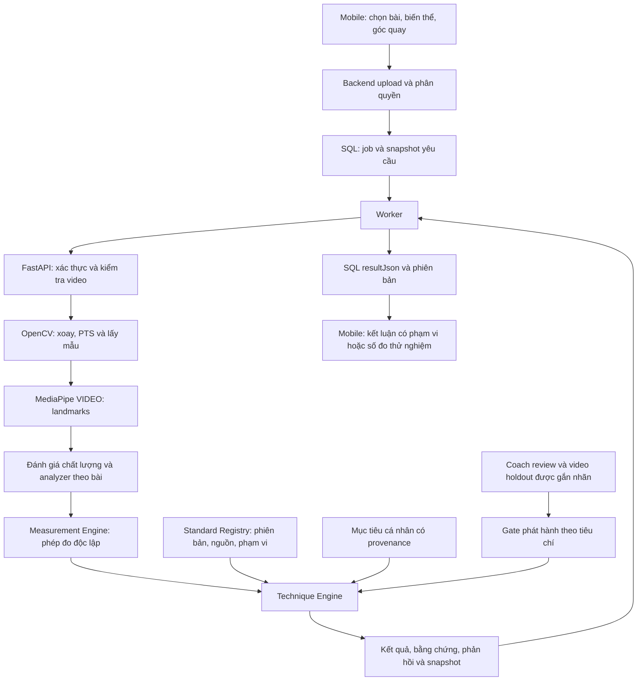

# AI Exercise Technique Evaluation — trạng thái triển khai

Ngày: 2026-10-31. Technique engine: `technique-evaluation-2`; bộ phân đoạn Squat: `squat-observation-6`.

**Trạng thái: EXPERIMENTAL / PARTIAL. Chưa có bài nào đạt Definition of Done để công bố đánh giá kỹ thuật đã được Coach kiểm chứng.** Đã triển khai kiến trúc, phép đo, điều kiện so sánh, bằng chứng, phản hồi, phiên bản tiêu chuẩn và luồng kiểm chứng. Chưa có phê duyệt chuyên môn hoặc video có nhãn độc lập; không tự tạo dữ liệu đó và không bật MEETS_CRITERION/NEEDS_IMPROVEMENT cho các bản nháp hiện có.

## Audit và nguyên nhân

MediaPipe tạo landmarks; vẽ skeleton không chứng minh kỹ thuật đã đạt. State machine trong `rules.py`/`squat_criteria.py` tách chu kỳ và đo nhịp. Các phép so sánh hông/gối/thân hiện có dùng ngưỡng thuật toán thử nghiệm; `NO_SIGNAL` chưa phải ĐẠT. Bản trước còn đọc measurement từ tiêu chí đã được đánh giá, nên thiếu mục tiêu độ sâu/nhịp làm biến mất số đo dù khớp đủ rõ. Bản này lấy phép đo trực tiếp từ pose và rep trước khi xét mục tiêu hoặc phê duyệt.

Điều kiện đầu video đã được sửa ở v5/v6, giữ tìm đoạn đứng phù hợp trong clip, bỏ rep đầu dở, timestamp VIDEO tăng nghiêm ngặt và đọc frame liên tiếp theo PTS. Lớp mới giữ các giới hạn tracking; không hạ ngưỡng để ép có kết quả. Xem [báo cáo v6](DEBUG_REPORT.md) cho lỗi phân đoạn ban đầu và [diagnostics theo video](evaluation/PIPELINE_DIAGNOSTICS.md).

## Kiến trúc

`analyzers.py` có interface chung, SquatAnalyzer thực sự tách rep, còn ProjectedMeasurementAnalyzer xử lý phép đo riêng theo bài và khai báo phân đoạn `NOT_IMPLEMENTED`. Không tạo các analyzer rỗng rồi đánh dấu SUPPORTED. Chưa triển khai nhận diện tự động bài tập; kết quả ghi `exerciseSelection.source=USER_SELECTED`, `recognized=false`.

## Exercise Standard Schema và phiên bản

[JSON Schema](standards/exercise-standard.schema.json), [registry](standards/index.json), [công cụ xem/rà tiêu chí](standards/review.html).

Mỗi chuẩn lưu exerciseId/name/variant/equipment/trainingLevel, nguồn tham khảo, startingPosition, movementPhases, standardVersion và history. Mỗi criterion có ID, loại A/B/C/D, biến thể/góc/khớp, phép đo, cách đối chiếu, điều kiện đạt/cần cải thiện/không đủ dữ liệu, yêu cầu bằng chứng, lời khuyên, giới hạn và trạng thái kiểm chứng. `measurementConfiguration`, `algorithmThresholds`, `individualTrainingTargetSchema` và `evaluationPolicy` là các cấu trúc riêng.

Nguồn định tính: [ACE Bodyweight Squat](https://www.acefitness.org/resources/everyone/exercise-library/135/bodyweight-squat/), [NSCA Optimizing Squat Technique](https://www.nsca.com/education/videos/bridge-series/bridge-optimizing-squat-technique/) và các trang ACE theo từng bài trong registry. Nguồn này không phê duyệt các ngưỡng số của phần mềm. MediaPipe là nguồn kỹ thuật về landmarks. Tất cả `approvedByCoach/approvedAt` hiện là `null`; không có tuyên bố ACE/NSCA chứng nhận hệ thống.

Snapshot tiêu chuẩn/digest được lưu ngay trong `resultJson`; lịch sử giữ version cũ khi thư viện thay đổi. Backend dùng các bảng ExerciseAnalysis/Sharing/Feedback hiện có; không cần migration mới. Payload danh sách lịch sử bỏ landmark/trace/snapshot lớn; chi tiết giữ đầy đủ.

## Ma trận tiêu chí Squat

| ID | Nội dung | Phép đo đã có | Điều kiện kết luận hiện tại |
|---|---|---|---|
| SQUAT-01 | Chu kỳ hoàn chỉnh | Đứng–xuống–lên, đầu/đáy/cuối, thời gian | MEASURED; phân đoạn thử nghiệm |
| SQUAT-02 | Độ sâu | Trung vị vị trí hông–gối/chiều dài đùi quanh đáy, góc gối/hông | Góc ngang; vẫn đo khi không đặt mục tiêu; chưa duyệt ngưỡng đạt |
| SQUAT-03 | Chuyển động gối | Hai bên riêng, dịch chuyển gối so bàn chân, góc gối, độ trôi cổ chân và khớp thật | Chính diện; mô tả nhiều số đo, không chẩn đoán chụm gối |
| SQUAT-04 | Chuyển động thân | Góc thân ở đáy/đầu pha lên, chênh nâng hông–vai | Góc ngang; không suy ra độ cong cột sống |
| SQUAT-05 | Kiểm soát chuyển động | Thời gian xuống/lên và chênh với trung vị clip | Không cần mục tiêu để đo; chưa duyệt điều kiện đạt |
| SQUAT-06 | Quan sát hai bên | Khác biệt góc và độ cao hông hình chiếu | Có thể đo chính diện; NOT_SUPPORTED cho kết luận đối xứng kỹ thuật |
| SQUAT-07 | Quan sát gót | Hướng gót–mũi chân trên ảnh nếu rõ | NOT_SUPPORTED cho tiếp xúc/lực ở sàn, không có hiệu chuẩn sàn |
| SQUAT-08 | Mục tiêu cá nhân | Đầu vào nhịp/độ sâu, tách targetValue và targetSource | Mục tiêu từ người dùng là ngữ cảnh; kết luận cần quy tắc đã duyệt và provenance |

Các dòng `perRep` có repNumber/start/bottom/end/timestamp, observedValue/units, landmarkEvidence chứa tọa độ và visibility thật, độ phủ, khoảng mất dấu, kiểm tra tham chiếu và giới hạn. Visibility là độ rõ khớp, không phải xác suất kỹ thuật đúng. `sampleCount` của tiêu chí hai bên có thể là số quan sát khớp-bên, không phải số frame duy nhất; không dùng nó làm tỷ lệ frame.

## Ma trận bài tập

| Bài/biến thể | Triển khai hiện có | Phân đoạn | Kết luận kỹ thuật đã kiểm chứng |
|---|---|---|---|
| Bodyweight Squat | 8 nhóm trên | Rep thử nghiệm, camera SIDE/FRONT/OBLIQUE có giới hạn | Chưa bật |
| Push-up cơ bản | Góc khuỷu, đường vai–hông–cổ chân | Chưa triển khai; chỉ đo toàn clip | Chưa bật |
| Front Plank | Góc thân, độ lệch hông với đường vai–cổ chân | Chưa có tách đoạn giữ; không đếm rep | Chưa bật |
| Lunge tiến không tạ | Góc gối/ thân phía rõ hơn | Chưa xác nhận chân trước hay chu kỳ | Chưa bật |
| Dumbbell Curl đứng | Góc khuỷu, góc tay trên với thân | Chưa triển khai rep/grip recognition | Chưa bật |
| Dumbbell Shoulder Press ngồi | Góc khuỷu, độ cao cổ tay so vai/thân | Chưa triển khai rep | Chưa bật |

Biến thể có tạ hoặc chưa xác định không tự nhận bộ chuẩn Bodyweight Squat. Các mục chọn bài trên Mobile ghi rõ “chỉ đo khớp”/“đếm rep thử nghiệm”, tất cả `supportStatus=EXPERIMENTAL`.

## So sánh và phản hồi thật

`criterion_evaluation.py` thực thi điều kiện phạm vi số hoặc mục tiêu/dung sai được khai báo rõ. Điều kiện cải thiện phải tường minh; vùng không được duyệt sẽ từ chối kết luận. Runtime chỉ phát quyết định khi phiên bản tiêu chuẩn được duyệt, nội dung không đổi sau review, đúng biến thể/camera/model/rule, tracking/bằng chứng đạt yêu cầu, và artifact kiểm chứng khớp hash. Gate tính lại metrics từ video/nhãn/inference gốc, kiểm tra số mẫu và chỉ tiêu chấp nhận đã chốt trước; riêng cờ `validated=true` không đủ kích hoạt. Không có artifact phát hành thật trong repo hiện tại.

Nếu một tiêu chí được phát hành sau này, mỗi verdict ghi giá trị đo/target, rep/timestamp, landmarkEvidence, nguồn/phiên bản và feedback có vấn đề, lý do ngoài điều kiện, 1–2 cách thử điều chỉnh, cách quay lại và khi cần Coach xem. Hiện `MEASURED`, `UNABLE_TO_ASSESS`, `NOT_SUPPORTED` mô tả đúng số đo và giới hạn. Các dấu hiệu Squat cũ vẫn ghi Experimental Observation; không chuyển `NO_SIGNAL` thành ĐẠT. Không chấm điểm toàn thân 0–100.

## Giáo án và Mobile

Backend kiểm tra giáo án thuộc hội viên và đang ACTIVE, đối chiếu đúng tên bài, lưu snapshot Coach/planVersion/mục tiêu hiệp–rep–tạ–ghi chú. Nếu có nhiều bài trùng, ghi rõ chưa chọn hiệp cụ thể. Giáo án hiện chưa có target kỹ thuật dạng cấu trúc: không lấy số trong ghi chú làm ngưỡng, không tự sửa giáo án. Engine có contract cho individual targets có người cấu hình/thời điểm/đơn vị/biến thể; phần authoring và phê duyệt target riêng theo giáo án cần hoàn thiện sau khi có bộ tiêu chí được duyệt.

Mobile có chọn bài và biến thể rõ ràng; phần tổng quan và kết luận có phạm vi, số tiêu chí đạt/cần cải thiện/chưa kết luận; các số đo và mục thiếu được thu gọn. Có skeleton thêm khuỷu/cổ tay, chọn rep, chạm timestamp, đánh dấu các khớp cung cấp bằng chứng và cách thử lại. Chỉ so sánh lịch sử cùng bài/biến thể/góc camera. Player cũ giữ dữ liệu lịch sử; kết quả cũ không tự tính lại. Không có Android emulator kết nối trong lần này, nên chưa nghiệm thu thao tác thiết bị thật.

## Video và kiểm thử

[6 video thật và số đo theo tiêu chí](evaluation/TECHNIQUE_SMOKE.md), [manifest/hash](evaluation/technique-video-manifest.json), [benchmark 21 lượt inference Lite/Full/Heavy](evaluation/POSE_BENCHMARK.md).

Squat chính diện: 165/165 mẫu có pose, 5 rep, 5 nhóm có phép đo (01/03/05/06/08); góc ngang có số đo độ sâu dù không chọn mục tiêu. Push-up 157/157, Plank 80/80, Lunge 74/74, Curl 131/131 pose; mỗi bài có hai phép đo hình chiếu. Shoulder Press 40/53 pose, bị từ chối ở bước chất lượng vì 10 frame có nhiều pose; vẫn giữ số đo thử nghiệm, không ép thành đạt. Không có nhãn Coach độc lập, nên accuracy/precision/recall kỹ thuật chưa có giá trị để công bố.

[API thật sau khi nạp mã cuối](evaluation/private/technique-smoke/live-side-no-goal.json): Squat góc ngang, mục tiêu `NONE`, 2 rep và 2 số đo SQUAT-02 được giữ ở `MEASURED`. `/health` trả `technique-evaluation-2`; `/standards` có xác thực trả đủ 6 bản tham chiếu.

Benchmark cùng 7 clip: Lite 98,5% pose / 34,924s; Full 99,4% / 38,157s; Heavy 99,3% / 63,855s. Thời gian gồm khởi tạo/giải mã, một lượt mỗi clip; proxy biến thiên góc chịu cả chuyển động thật, chưa phải đo jitter. Heavy không vượt trội mọi tiêu chí; API giữ Lite. Báo cáo có hash model/video, frame rate, core-valid rate, số đo hữu ích và peak process RAM.

101 Python tests qua, bao gồm logic, dữ liệu pose thật, registry, evaluator, gate phiên bản/variant/camera/quality/target và kiểm tra không sinh kết luận từ draft. Fixture hình học/phê duyệt mô phỏng chỉ kiểm tra nhánh phần mềm, không phải video gắn nhãn hoặc xác nhận chuyên môn. Backend typecheck và Mobile typecheck qua; Mobile lint 0 lỗi, 2 cảnh báo unused có sẵn. Bộ 15 unit/media/PT policy tests đã qua; 3 integration Upload/Worker/sharing và 52 PT Booking/Wallet qua trên database test tạm. Thêm 1 integration gọi AI thật: HTTP multipart → worker → FastAPI/MediaPipe/Technique Engine → SQL → API detail/history trả 5 rep và 8 tiêu chí. [Artifact integration](../backend/tests/artifacts/real-ai-integration.json) xác nhận snapshot/model/rule, dữ liệu skeleton và không dùng PT credit. Test DB được xóa sau chạy; không chạy migration vào application/production DB. Đây là kiểm thử hợp đồng HTTP, chưa bao gồm thao tác màn Mobile thật hoặc callback PayOS mạng thật.

## Công cụ Coach và điều kiện còn thiếu

Chạy `python -m http.server 8765 --bind 127.0.0.1` từ thư mục service, rồi mở `/standards/review.html` để rà nguồn/tiêu chí và `/evaluation/coach-technique-review.html` để gắn nhãn rep/đoạn giữ, từng tiêu chí và timestamp. Trang hoạt động cục bộ, xuất JSON, không upload video. Phiếu xuất là hồ sơ người duyệt khai báo, cần kiểm tra chuyên môn độc lập. [Quy trình phát hành](standards/RELEASE_PROCESS.md) mô tả tách người/buổi, chốt chỉ tiêu trước, chạy policy candidate ngoại tuyến, kiểm tra bất đồng giữa Coach, và chỉ phát hành đúng phạm vi đã chứng minh.

`evaluate_technique.py` khóa hash video/nhãn/output, version/variant, ghép đoạn một-một, đếm FP/FN/abstention/false acceptance và repCountMAE. [Report hiện tại](evaluation/TECHNIQUE_VALIDATION.json) là `INSUFFICIENT_GROUND_TRUTH`: 0 video holdout được Coach gắn nhãn. Cần Coach đủ chuyên môn xem/duyệt điều kiện và gắn nhãn thực tế, tốt nhất hai người độc lập trên tập quan trọng. Không thể hoàn thành bước này chỉ bằng sửa source hoặc tải video công khai.

Tiếp theo: rà soát/duyệt Bodyweight Squat và mục tiêu cá nhân có cấu trúc; thu nhãn độc lập, chạy candidate offline và phát hành từng tiêu chí đạt điều kiện đã chốt. Sau đó triển khai bộ phân đoạn riêng cho Push-up/Plank/Lunge, rồi Curl/Press, với test camera/variant riêng. Không bật nhãn SUPPORTED trước khi đáp ứng các điều kiện đó.

## File sửa/thêm chính

`main.py`, `analyzers.py`, `measurement_engine.py`, `squat_measurements.py`, `technique_engine.py`, `criterion_evaluation.py`, `exercise_catalog.py`, `standard_registry.py`, `standards/*`, `run_technique_smoke.py`, `benchmark_pose_models.py`, `evaluate_technique.py`, `evaluation/coach-technique-review.html`, các manifest/report/test tương ứng; Backend `exerciseAnalysis.catalog.ts`, `exerciseAnalysis.service.ts`, `exerciseAnalysis.utils.js`, `exerciseAnalysis.route.ts`, tests Upload/Worker/real-ai và runner SQL tạm; Mobile `exerciseAnalysis.ts`, `exercise-analysis.tsx`, `ExerciseAnalysisResult.tsx`. Toàn bộ thay đổi nằm trong luồng AI và công cụ kiểm chứng của nó.
