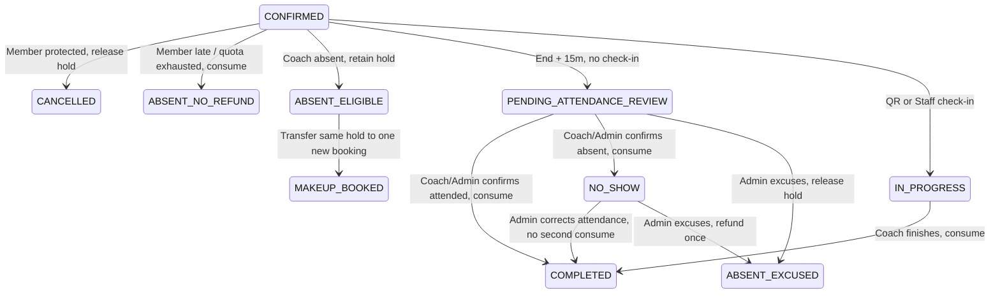
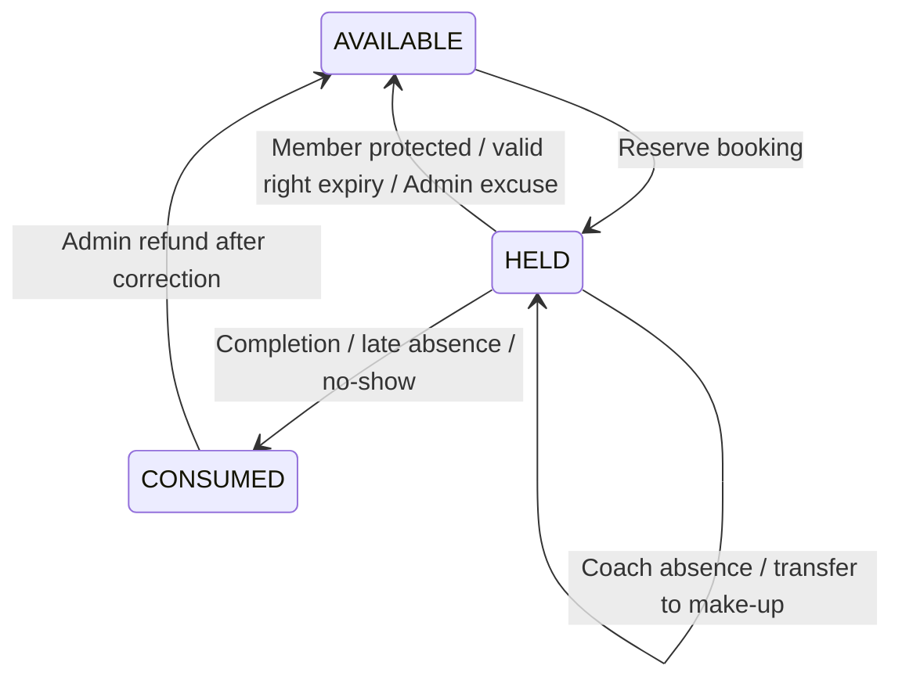
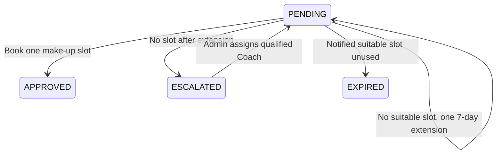

# PT absence, credit, make-up and attendance: policy implementation

Policy approved by the product owner. Scope: PT only. Gym access remains a prerequisite for a new PT slot; Gym Membership, PayOS and Group Class behavior is unchanged. All times are stored as UTC instants and PT calendar days are interpreted in `Asia/Ho_Chi_Minh`.

## Policy delta and impact

| Area | CURRENT before this work | ISSUE found | PROPOSED / implemented | IMPACT |
| --- | --- | --- | --- | --- |
| Member absence | At least two hours before start; 3/1/1 protected cancellations by paid package/single/gift lot; late or exhausted cancellation consumes one session. | Preview and POST previously disagreed; historical `MEMBER_MAKEUP` could evade quota. | Use one policy inside the POST transaction, count historical protected use, release the original allocation to its exact purchase lot. | PT controller, policy tests; no new member benefit. |
| Coach absence | Direct endpoint granted seven-day make-up; availability endpoint waited for Admin approval. | Divergent approval and accounting paths. | Both endpoints call `reportCoachAbsence`; Coach owner can report directly, entitlement is granted in the same transaction, Member and Admin are notified. | PT API, Coach availability, audit log. |
| Protected make-up | A pending right transferred one HELD allocation to a new booking. | No durable reason/chain, extension or qualified replacement; Trial could be canceled by the coverage worker after package expiry. | Record `cause=COACH`, root, absence count, one active right per chain. Preserve one HELD allocation through package expiry and one automatic seven-day extension; if still unschedulable, escalate to Admin. Member may request a different qualified Coach before the deadline; Admin assignment is audited and does not add Credit. | Additive schema/migration, worker, booking service, Admin/Mobile. |
| Suitable slot and expiry | Worker expired any pending right after seven days. | Coach/Gym lack of availability could silently remove a Member right. | Capture bookable slots and Member notifications together. Only a previously notified, still suitable slot permits ordinary expiry/release. No suitable slot leads to one extension, then `ESCALATED` with HELD Credit. | Slot evidence/notifications, worker. A slot needs two-hour booking lead, no overlap, active Coach and valid Gym. |
| Attendance | End +15 minutes without QR became charged no-show. | A Member who trained without check-in could be mislabeled. | End +15 minutes enters `PENDING_ATTENDANCE_REVIEW`; Credit stays HELD. Coach has 24 hours to choose attended/no-show, both settling one session. Timeout sends Admin a review task; Admin can decide attended/no-show/excused and audit every decision. | Review/event tables, worker, Coach/Admin/Mobile. |
| Repeat Coach absence | Each new make-up booking could generate another independent request. | No chain guard or second-absence escalation. | One active right per root chain, no added Credit. Second Coach absence flags Admin for Coach reassignment. | Unique filtered index, chain tracking, Admin queue. |
| Legacy PT | Backfilled `LEGACY_PT` lots have uncertain source benefits. | 3/1/1 cannot safely be inferred or applied retroactively. | Leave balances and transactions untouched. Admin queue lists legacy lots with origin, counts and package metadata for manual classification. | Read-only Admin API/Mobile; no historic financial migration. |

## State machines and accounting invariants

`MakeUpRequest` is a right to transfer one existing HELD allocation, never an additional AVAILABLE Credit. `PtCreditBatch.heldCount + usedCount <= initialCount`. Conditional status updates, SQL application locks, serializable transactions and a filtered unique active-chain index prevent duplicate reservation, refund, settlement and make-up. A Coach absence does not spend Member preservation quota. Member absence or no-show on a make-up booking consumes its one transferred hold. Expired PT package or Trial does not invalidate an already granted Coach-caused right; a new booking still needs valid Gym access for that slot.

## Migration and rollout

`20261109_pt_absence_review_and_makeup_protection/migration.sql` only adds fields, event/review tables and a filtered unique index. Existing `MakeUpRequest` rows default to `LEGACY`; only pending rows with explicit Coach/Trainer/Admin `cancelledBy` are marked `COACH`. Their old status, deadline and Credit stay intact. Historic rows have null chain root, so the index does not force a speculative mapping. No SQL Server reset or historic Credit rewrite is performed.

The migration was applied to `fitness_db` on 2026-11-06 after a checksum-verified COPY_ONLY backup and a successful restore/migration on `fitness_pt_acceptance_20261106`. Pre/post SHA-256 hashes of Booking, PtCreditBatch, PtBookingCreditAllocation and PtCreditTransaction matched; Credit invariants had zero violations. The source database had zero `LEGACY_PT` lots and zero existing make-up rights, so historic entitlement mapping remains unverified. The Admin operations endpoint exposes the first 100 legacy lots and a total count; export all rows separately for a full audit. Candidate mapping: explicit verified paid PT purchase -> paid lot; verified Gym gift -> Trial lot; legacy PT package without verifiable purchase/benefit -> Admin review. Do not assign 3/1/1 or adjust any legacy Credit until the source and intended benefit are verified and approved.

## Verification and open checks

The isolated SQL Server runner applied all 26 migrations to a randomly named test DB and removed it. PT wallet integration: **72/72 passed**; exercise isolation suite: **6/6 passed**. PT policy unit suite: **5/5 passed**. Tests cover Member two-hour/quota/lot handling, both Coach absence APIs and repeat absence, Member-selected Coach and desired slot, Admin approval/rejection, concurrent requests, a slot taken before approval, one extension and escalation, captured slot notifications, qualified reassignment, package/Trial expiry, Coach-bound Credit rejection and rollback, concurrent booking, attendance review/timeout, one-time consumption/refund, and job replay. Backend, Mobile and web TypeScript checks pass; web production build passes.

Still needed before claiming end-to-end completion: audit an environment containing actual `LEGACY_PT` records; run the minute worker across real clock boundaries; verify notification delivery, slot evidence and Admin decisions with actual accounts; test Member, Coach and Admin screens on a device. The Mobile lint baseline remains 14 errors and 18 warnings in unrelated navigation/drawer/chat code. The main DB migration passed, but live-device business acceptance has not been performed.

## Member-selected make-up Coach (20261110)

Member now selects only an active, qualified replacement Coach and provides a reason. No date or slot is required at this stage. `requestedCoachId`, `requestReason`, and `coachChangeRequestedAt` live on the existing `MakeUpRequest` row; `requestedStartAt` remains nullable for compatibility with older requests but new requests leave it null. These fields represent one pending approval, not a booking or extra Credit. The existing `PtMakeUpEvent` and `ActionLog` retain each proposal and Admin decision. While a selection is pending, the expiry worker keeps the original `HELD` allocation and booking is blocked. Admin approval rechecks Coach qualification and active status inside one serializable transaction, then changes only `assignedCoachId` and opens at least seven days for Member booking. The Member chooses a date and slot afterward; the booking transaction checks availability, overlap, Gym coverage and expiry. Rejection requires a reason, clears the pending selection, keeps the right under Admin care, and permits another Member choice. Admin can suggest another qualified Coach on rejection or assign one directly as an audited exception. Neither path creates a new Credit or right.

Migration `20261110_pt_makeup_member_coach_choice` adds only four nullable columns. It was applied to `fitness_db` after a checksum-verified COPY_ONLY backup at `C:\Program Files\Microsoft SQL Server\MSSQL15.HODANGQUANG\MSSQL\DATA\fitness_pt_makeup_choice_20261106.bak`, restore to `fitness_pt_makeup_choice_copy_20261106`, and successful migration on that copy. Post-migration SHA-256 hashes and row counts of Booking (13), PtCreditBatch (6), PtBookingCreditAllocation (6), and PtCreditTransaction (16) matched the migrated copy exactly. Make-up right #1 remained `PENDING`, and zero Credit lots had negative counters. Restore from that backup is the rollback path if schema rollback is required; coordinate the restore with any bookings or payments created after the backup. Live Member/Admin UI and notification delivery remain for the user's manual acceptance.

## Package vs make-up Coach change scope

The package request uses `PtCoachChangeRequest` keyed by `batchId` and always waits for Admin approval. Its approval changes only the purchased batch `coachId`, eligible ordinary future PT bookings, and package training plans. Already booked make-up sessions and pending `MakeUpRequest` rights stay with their own Coach and retain their `HELD` allocation. The make-up request uses `MakeUpRequest` keyed by one right; approval changes only `assignedCoachId` and its protected booking deadline. Both paths use the same active Coach and specialization validator but have separate transactions and write sets. No schema migration is needed for this separation. Package approval does not consume the make-up right, add Credit, or change the Coach on an existing make-up booking.

Admin must call `GET /pt/coach-change-requests/:id/preview` before approving a package change. Each future ordinary booking with a `HELD` allocation from that batch is classified by active Coach qualification, Vietnam-local shift or date override, Gym closure, Coach overlap, and Member overlap. A transferable booking keeps its time, status and allocation while only `coachId` and any stale QR token change. If the new Coach cannot take a booking starting in strictly less than two hours, that booking stays with the old Coach, its time/status and `HELD` allocation stay intact, and it is shown separately in the Admin preview. This package transfer approval cannot cancel that booking. Any later cancellation by Member consent or Admin exception requires its own explicit, audited handling outside this approval path. Other unavailable future bookings are cancelled and their held Credit is released to the same batch without a member absence quota entry. Admin sends the preview token on approval; the serializable transaction locks the PT calendar, both Coaches and Member, recomputes the plan, and rejects with 409 if the plan differs, including when the booking crosses the two-hour boundary. The Admin then previews again. Historical, started, in-progress and make-up bookings are outside this write set. The transaction records the actual booking IDs and a durable Member notification listing transferred, retained-with-old-Coach, and cancelled times. This change requires no DB migration. Previous approvals that already cancelled bookings are not rewritten retroactively.

Verification after short-notice protection: the isolated local SQL Server runner applied all 26 migrations, passed its exercise suite and **82/82 PT integration** tests, then removed the test database. These tests cover retaining the old Coach and `HELD` Credit, stale preview at the two-hour boundary, and the exact two-hour rule, as well as the earlier package transfer cases. Backend TypeScript and web production build passed. Live Admin/Member UI acceptance and notification delivery on the deployed environment remain to be checked.
